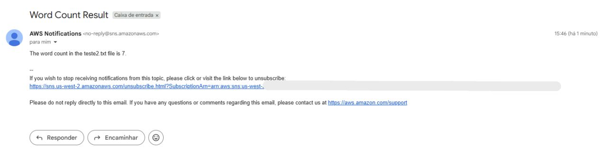
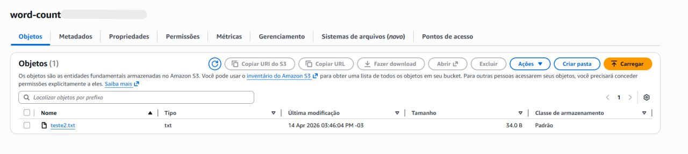
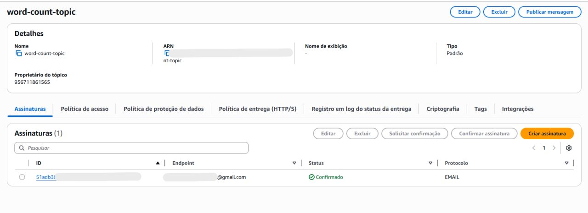
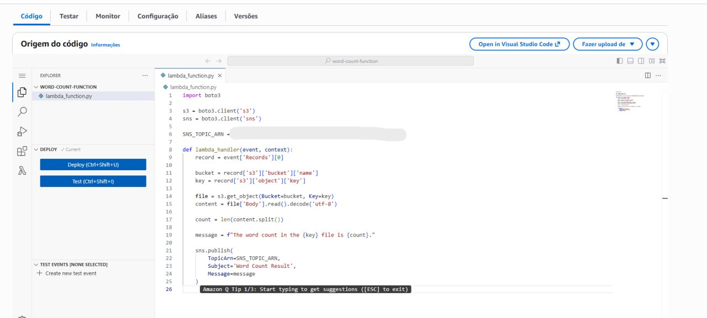
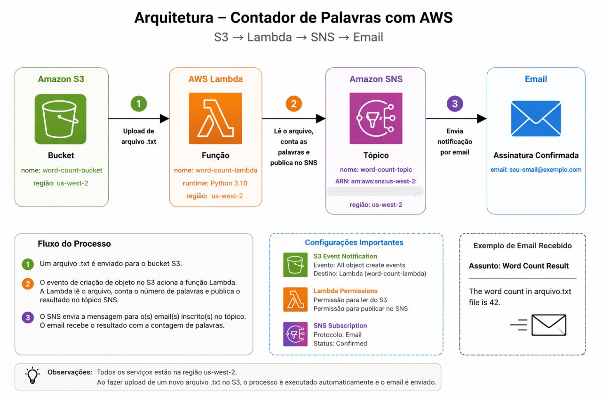

# 🚀 Laboratório Prático de Cloud Computing — AWS

Concluí mais um laboratório prático na área de **Cloud Computing pela Escola da Nuvem**.

Neste desafio, trabalhei com **automação utilizando serviços da AWS**, construindo um fluxo completo orientado a eventos.

## 🔧 Tecnologias utilizadas

- 🔹 **AWS Lambda** – responsável por processar o arquivo e realizar a contagem de palavras automaticamente.
- 🔹 **Amazon S3** – utilizado para armazenar o arquivo e disparar o evento ao realizar o upload.
- 🔹 **Amazon SNS** – encarregado de enviar a notificação por e-mail com o resultado.

## 💡 O que desenvolvi na prática

Implementei uma solução onde, ao realizar o **upload de um arquivo de texto em um bucket do S3**, uma função **Lambda é automaticamente acionada** para processar o conteúdo e contar o número de palavras.

📩 Após o processamento, o resultado é enviado via e-mail utilizando o **Amazon SNS**, garantindo uma notificação automática e em tempo real.

## 📈 Principais aprendizados

- ✔️ Integração entre serviços na AWS
- ✔️ Arquiteturas orientadas a eventos
- ✔️ Computação serverless na prática
- ✔️ Automação com baixo acoplamento

Cada laboratório reforça ainda mais como é possível construir soluções **escaláveis e eficientes na nuvem**.

**Seguimos evoluindo 🚀**

---

---

---

---
